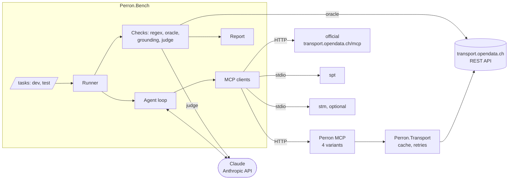
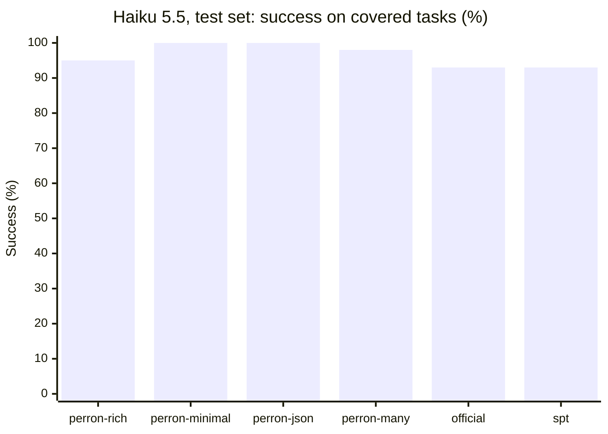
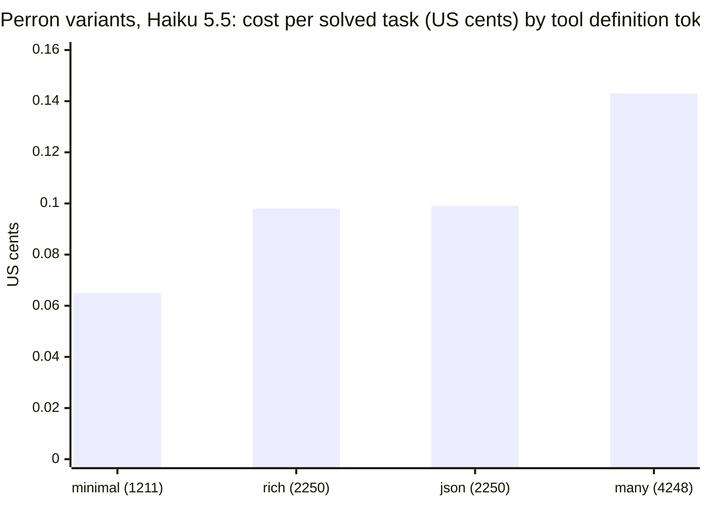

# Perron

[](https://github.com/juandroo1/perron/actions/workflows/ci.yml)

**How much does tool design (number of tools, descriptions, result format) affect how well an agent solves tasks?**

Perron answers this for Swiss public transport, a domain with several existing MCP servers and live data:

1. **Perron MCP:** an MCP server in .NET for Swiss public transport (stops, connections, departures), based on [transport.opendata.ch](https://transport.opendata.ch).
2. **Perron Bench:** an eval harness in .NET that runs the same agent tasks against several MCP servers (Perron, its variants and existing servers) and compares task success, tool calls, tokens, cost and latency.

The goal is an honest, reproducible comparison, not a leaderboard Perron has to top.

**Short answer.** In the range tested, tool design changed what a solved task costs, not measurably how many tasks were solved:

- Three or seven tools, rich or one-sentence descriptions, text or JSON results, Perron or two existing servers: on the held-out test set every server solved 93–100 % of its tasks with Claude Haiku 5.5. No paired difference excludes 0.
- The cost per solved task follows the size of the tool definitions and the number of calls. Seven tools instead of three cost 46 % more per solved task, one-sentence descriptions 34 % less.
- What did make tasks fail were missing capabilities, not wording. No server could ask for a minimum transfer time until Perron got one, and incomplete tool output (arrivals without times) made the smaller model fail where the larger one worked around it.


## Architecture



- **Perron MCP** (`src/Perron.Mcp`) offers three read-only tools over Streamable HTTP and stdio. Its variants switch the tool cut, the descriptions and the result format, one at a time.
- **Perron.Transport** (`src/Perron.Transport`) is a typed client for transport.opendata.ch with caching and retries.
- **Perron Bench** (`src/Perron.Bench`) connects to every server with the official MCP C# SDK, runs each task in an agent loop with Claude, stores a trace per run and scores it from the trace alone: an oracle checks the named connection against the transport API, a grounding check looks for times that appear in no tool result, and an LLM judge grades ambiguous and bad input tasks.

## Results

Final comparison on the held-out test set: 20 tasks, 3 repeats per task and server, run on 2026-11-26 (Perron at commit `53a4d91`). Analysis in [`bench/analysis/test-final.md`](bench/analysis/test-final.md), full reports for [Haiku](bench/results/20261126-193532-test/report.md) and [Sonnet](bench/results/20261126-201722-test/report.md).

**Claude Haiku 5.5, all servers** (19 tasks covered by every server; the occupancy task only by `spt`):

| Server | Tools | Tool definition tokens | Success, covered tasks (95 % CI) | pass^3 | Difference to perron-rich (95 % CI) | Tool calls per run | Tokens per run | Cost per solved task |
|---|---|---|---|---|---|---|---|---|
| perron-rich | 3 | 2250 | 95 % (86–100) | 89 % | – | 1.5 | 7085 | $0.00098 |
| perron-minimal | 3, one-sentence descriptions | 1211 | 100 % (100–100) | 100 % | +5 pp (0 to +14) | 1.3 | 4454 | $0.00065 |
| perron-json | 3, results as JSON | 2250 | 100 % (100–100) | 100 % | +5 pp (0 to +14) | 1.5 | 7681 | $0.00099 |
| perron-many | 7 | 4248 | 98 % (95–100) | 95 % | +4 pp (0 to +9) | 1.5 | 11748 | $0.00143 |
| official | 4 | 1386 | 93 % (81–100) | 89 % | −2 pp (−14 to +7) | 1.8 | 8565 | $0.00128 |
| spt | 4 | 2063 | 93 % (85–100) | 85 % | −2 pp (−7 to +4) | 1.8 | 9007 | $0.00128 |

**Claude Sonnet 5.5, control** (servers of the main comparison):

| Server | Success, covered tasks (95 % CI) | pass^3 | Difference to perron-rich (95 % CI) | Tokens per run | Cost per solved task |
|---|---|---|---|---|---|
| perron-rich | 100 % (100–100) | 100 % | – | 6373 | $0.0160 |
| official | 95 % (86–100) | 89 % | −5 pp (−14 to 0) | 6020 | $0.0171 |
| spt | 97 % (92–100) | 90 % | −4 pp (−9 to 0) | 7129 | $0.0190 |





- **Success:** the mean over tasks of the share of passed runs, with a 95 % bootstrap interval over tasks. Differences are paired on the tasks both servers cover; only a difference whose interval excludes 0 would support a claim, and none does.
- **Cost:** without prompt caching, the basis of comparison, because caching favours servers with large tool definitions. The judge is not counted. With caching the runs cost $0.21 (Haiku, 345 runs) and $1.53 (Sonnet, 174 runs).
- **Target of the spec** (at least 0.85 for Perron with Haiku, with an interval): reached, 95 % with a lower bound of 86 %.
- **Development set:** before the final comparison, Perron was improved on the 25 development tasks. The baseline over all servers ([report](bench/results/20261126-105446-full/report.md)) had 87–94 % success for every server; after the changes of task 4.2 ([analysis](bench/analysis/dev-baseline.md)) the Perron variants reached 93–100 %. These numbers favour Perron, because only Perron was changed after reading its failures.

## What the benchmark shows about tool design

1. **Cut, wording and format of the tools did not change success measurably.** Neither seven tools instead of three, nor one-sentence instead of rich descriptions, nor JSON instead of text results: no paired interval excludes 0, on the development set or on the test set. With 19 to 25 tasks and success near the ceiling, small effects would not show (see the limitations).
2. **The size of the tool definitions sets the cost.** With the same data and results, cost per solved task rises with the definitions: 1211 tokens $0.00065, 2250 tokens $0.00098, 4248 tokens $0.00143 (Haiku, test set). The definitions go with every model call. Across servers the number of calls matters as much: `official` has the smallest definitions but makes more calls with longer results, and costs about 30 % more per solved task than `perron-rich`.
3. **A missing capability costs more than any wording.** In the development baseline, dev-009 (at least 10 minutes per transfer) failed on every server in every run: no server could ask for a minimum transfer time, and the agents fell back to a later direct train. Perron got `min_transfer_minutes` in task 4.2. On the held-out test-008 (at least 15 minutes per transfer, with a pram) all 15 Perron runs used it and passed; `official` and `spt` had to work around it via other stops and failed 3 of 12 runs. This is one task per set, an observation rather than a statistical result.
4. **Let the tool resolve ambiguous names.** On dev-017 ("Buchs") Haiku often added a canton itself before the tool could list the candidates. One sentence in the rich descriptions ("Pass place names as the user wrote them; do not add a canton or region yourself.") fixed it for `perron-rich` (2 → 3 of 3 runs), not for `perron-minimal` (0 of 3).
5. **Incomplete results hurt the smaller model more.** On test-011 (first arrival at Brig) the arrivals of `official` came without times: Haiku failed 3 of 3 runs, Sonnet worked around it in 3 of 3. One task.
6. **A larger model buys a few points at a high price.** Sonnet 5.5 solved a few more tasks on every server than Haiku 5.5 (perron-rich 95 → 100 %, official 93 → 95 %, spt 93 → 97 %; separate runs) at about 16 times the cost per solved task.

## Methodology and fairness

The rules are fixed in [`CLAUDE.md`](CLAUDE.md), the methodology in [`plan.md`](specs/001-perron/plan.md), section 6.

- **Same conditions for every server:** the same model, system prompt, tasks, tool-call limit, `effort`, `max_tokens` and reference time in a task round; the order of the servers is shuffled per task. Server `instructions` go into a fixed section of the system prompt. The methodology is versioned in [`bench/bench.json`](bench/bench.json) and recorded in every run manifest.
- **Foreign servers as documented:** no patches, no rewritten tools. The stdio servers run with pinned versions (`spt` 0.1.10, `stm` 0.5.0) and dependencies pinned with hashes. The hosted `official` server cannot be pinned, so every run records the hash of its `tools/list`; it was the same in all runs (`f899f0f82cbb`).
- **Capabilities decided before the first run**, with reasons, in [`bench/servers.json`](bench/servers.json). A task a server cannot do (occupancy) counts as not covered, not as failed; the report shows success on covered and on all tasks.
- **Tasks written before the tools:** the development set by Claude, the test set by an isolated Claude subagent (task 1.3). The test set was frozen with its SHA-256, locked for reading in Claude Code and used once, for the final comparison.
- **Verify, don't recompute:** the oracle asks the transport API once per task round from the reference time; an answer passes if the connection it names exists, meets the constraints and is at most a few minutes worse than the best one. Planned and forecast times both count.
- **Judge:** Claude Haiku 5.5 grades ambiguous and bad input tasks against a rubric, blind to the server and its tool results.
- **Statistics:** 3 repeats per task and server, 95 % bootstrap intervals over tasks, paired differences, no claim without an interval that excludes 0.
- **Reproducible:** every run stores its manifest (commit, model, settings, hashes of prompt, task set and tool lists) and a trace per run; `bench rescore` scores stored runs again without model calls, `bench report` rebuilds the reports.

## Known limitations

- **Small task sets, success near the ceiling.** 25 development and 20 test tasks with 3 repeats. Most tasks are solved by every server, so the benchmark separates servers poorly; effects of a few percentage points would not be detected.
- **One day, live data.** All runs took place on 2026-11-26 against the live timetable, with relative dates ("tomorrow", "the day after tomorrow"). Other days, times or disruptions may give other results.
- **Task sets written by Claude.** The development set (`bench/tasks/dev.jsonl`) was written by Claude in the working session, the held-out test set by a separate Claude subagent without that session's context; both were spot-checked by a human. The working session never read the test set before the final comparison. Tasks written by the same model family that solves them may favour it, and the author of the development set knew the planned Perron tool design.
- **Perron tuned on the development set.** Perron's tools were improved after reading their failures on the development set; the foreign servers were not. Results on the development set therefore favour Perron. The test set is the fair comparison, but the minimum transfer time added after dev-009 also helps on the similar test-008.
- **One corrected test task.** The check of test-002 had a JSON escaping error (`\b` as a backspace) and failed every answer. It was corrected after the final runs and the stored runs were rescored without model calls; the agents never see the checks. See the [analysis](bench/analysis/test-final.md).
- **Only Claude models, and not every server.** Haiku 5.5 and Sonnet 5.5 at `effort` medium. `stm` needs an API key and was not part of any run.
- **Third-party Python servers** run with their dependencies as of their release date (`uv --exclude-newer`), because one of them no longer starts with today's dependencies.
- **Oracle check and partly named connections.** If an answer names the best arrival with a different departure time (for example the user's time) and an alternative in full, the check counts only the alternative and fails the run (dev-004, one run of `perron-minimal` after task 4.2).
- **Grounding check and French durations.** The hallucination rate counts a clock time that appears in no tool result. It reads French durations such as "2h21" as clock times and does not count times the agent put into its own tool calls, so on the test set 10 of 11 flagged runs are false positives. The rate does not decide whether a task passed.
- **Blind judge and real times.** The judge sees no tool results, so it sometimes calls correct times invented (test-015, three runs on foreign servers).
- **Judge checked by a model, not by a person.** The LLM judge was compared with a blind review by Claude (Opus 5.5) instead of a human review: 85 % agreement, Cohen's κ 0.38 on 60 verdicts, with two known disagreement patterns (see [Scoring](#scoring)).
- **Latency is rough.** The development baseline ran while the host was under heavy CPU load from other work.

## How this project is built

Perron is developed spec-first with Claude Code:

- [`spec.md`](specs/001-perron/spec.md) defines what and why: user stories, acceptance criteria, non-goals and open questions.
- [`plan.md`](specs/001-perron/plan.md) defines how: architecture, stack, tool design, benchmark methodology, and a decision log. Every deviation from the plan is recorded there before it is made, with its reason.
- [`tasks.md`](specs/001-perron/tasks.md) breaks the work into numbered tasks with checkboxes.
- [`CLAUDE.md`](CLAUDE.md) holds the rules for the agent: fairness, Git workflow, Docker as the reference environment, the definition of done.
- [`/next-task`](.claude/commands/next-task.md) runs one task at a time: read spec, plan and task, propose a plan and wait for approval, implement with tests, run build, format, tests and the Docker check, estimate benchmark cost with a dry run and ask before larger runs, then open a pull request. A human merges after green CI.
- The held-out test set is protected from the agent by a read lock in [`.claude/settings.json`](.claude/settings.json) and a rule in `CLAUDE.md`.

## Repository layout

```
src/
  Perron.Transport/   client for transport.opendata.ch, models, caching
  Perron.Mcp/         MCP server: tools, variants, transports, /health
  Perron.Bench/       harness: server registry, agent loop, checks, oracle, report
tests/                unit and integration tests (no live API calls)
bench/                server registry, task sets, results
specs/001-perron/     spec, plan and tasks (spec-driven development)
```

## Getting started

Requirements: .NET SDK 10.0.404 (pinned in `global.json`), Docker.

```bash
cp .env.example .env
dotnet build -warnaserror
dotnet test
```

### Run the MCP server locally

```bash
dotnet run --project src/Perron.Mcp                 # Streamable HTTP on http://localhost:8080/mcp, health on /health
dotnet run --project src/Perron.Mcp -- --stdio      # stdio transport
npx @modelcontextprotocol/inspector                 # inspect and call tools manually
```

Perron speaks both MCP protocol paths: the `initialize` handshake (revisions up to 2025-11-25) and per-request metadata with `server/discover` (2026-07-28). Over HTTP it runs stateless.

Tools (all read-only):

| Tool | What it does |
|---|---|
| `find_stops` | Finds stops by name or near a coordinate and returns ID, name, kind of stop (train, tram, bus …) and coordinates, plus the distance for a coordinate search. An ambiguous name such as "Buchs" lists the candidates (Buchs AG, Buchs SG …) with a hint to ask which one is meant. |
| `plan_trip` | Plans connections from one stop to another, optionally via up to two stops, leaving after or arriving before a time (local Swiss time), optionally with a minimum time per transfer. Each connection shows date, departure and arrival, duration, transfers, and every leg with line, direction, platforms, delays and transfer time. Stops can be names or IDs; an ambiguous name returns the candidates with IDs instead of connections. |
| `get_departures` | Shows the next departures or arrivals at one stop (name or ID), from now or a given time, optionally only some means of transport. Each entry shows time, delay, line, final destination and platform. Arrivals show the final destination too; the API does not provide where a vehicle comes from. |

Tool texts and results are in English. Every result ends with the attribution "Fahrplandaten: opentransportdata.swiss".

### Use with Claude Code and Claude Desktop

**Claude Code** reads `.mcp.json` in this repository, which points to Perron MCP from Docker Compose:

```bash
docker compose up -d --wait        # Perron MCP on http://127.0.0.1:8080/mcp
claude                             # in the repository; approve the project server "perron" once
```

`/mcp` in Claude Code shows the server and its tools. Without this repository, add it once for your user:

```bash
claude mcp add --transport http perron http://localhost:8080/mcp
```

**Claude Desktop** starts local servers itself over stdio. Build the image once (`docker compose build mcp`), then add Perron to `claude_desktop_config.json` (Windows: `%APPDATA%\Claude\claude_desktop_config.json`, macOS: `~/Library/Application Support/Claude/claude_desktop_config.json`) and restart Claude Desktop:

```json
{
  "mcpServers": {
    "perron": {
      "command": "docker",
      "args": ["run", "-i", "--rm", "perron-mcp:dev", "--stdio"]
    }
  }
}
```

This needs Docker but no .NET. With the .NET SDK instead, run `dotnet publish src/Perron.Mcp -c Release -o publish/perron` and use `"command": "dotnet", "args": ["<repository>/publish/perron/Perron.Mcp.dll", "--stdio"]`.

To try a variant, pass its settings, e.g. `"args": ["run", "-i", "--rm", "-e", "PERRON_TOOLS=many", "perron-mcp:dev", "--stdio"]`.

### Variants

For the benchmark ablations the same server runs in variants, chosen by environment variables (invalid values stop the start):

| Variable | Values | Default |
|---|---|---|
| `PERRON_TOOLS` | `standard` (3 tools) or `many` (7 finer tools with the same data and formats) | `standard` |
| `PERRON_DESCRIPTIONS` | `rich` (when to use a tool, when not, example) or `minimal` (one sentence, parameter meaning, format and range) | `rich` |
| `PERRON_FORMAT` | `compact` (short text) or `json` (the same fields as JSON) | `compact` |

Each variant reports its own name in `serverInfo`: `perron-rich` for the defaults, otherwise `perron-` plus the values that differ, e.g. `perron-minimal` or `perron-json`. Tool errors are plain text in every variant.

The tool cut `many` offers `search_stops_by_name`, `search_stops_near`, `get_connections_departing`, `get_connections_arriving`, `get_connections_via`, `get_departures` and `get_arrivals`.

Docker Compose runs the variants of the benchmark next to `mcp` (perron-rich) in the profile `bench`, reachable only inside the Compose network:

| Service | Variant | URL inside Compose |
|---|---|---|
| `mcp` | `perron-rich` | `http://mcp:8080/mcp` (also `http://127.0.0.1:8080/mcp` on the host) |
| `mcp-minimal` | `perron-minimal` | `http://mcp-minimal:8080/mcp` |
| `mcp-json` | `perron-json` | `http://mcp-json:8080/mcp` |
| `mcp-many` | `perron-many` | `http://mcp-many:8080/mcp` |

```bash
docker compose --profile bench up -d --wait mcp mcp-minimal mcp-json mcp-many
docker compose --profile bench run --rm bench check --servers perron-many
```

Errors are written for the agent, so it knows what to do next:

- **Invalid input** (unreadable date, unknown stop, too many via stops …): a tool error with a concrete hint, e.g. similar stop names.
- **Nothing found** (no connections, empty board, no stop for a search): a normal result with a hint, e.g. try another time.
- **API failures** (date outside the loaded timetable, throttling, timeouts, server errors): a tool error that says what happened and what to do, e.g. the timetable window or "wait about 30 seconds". Perron retries server errors and timeouts before giving up.

### Run with Docker

Docker is the reference environment.

```bash
cp .env.example .env                                  # once; optional until API keys are needed
docker compose up -d --build                          # Perron MCP on http://127.0.0.1:8080/mcp
docker compose ps                                     # mcp should be "healthy"
docker compose --profile bench run --rm bench check --servers perron-rich --expect-tools find_stops,get_departures,plan_trip   # connect, list tools
docker compose down
```

Images run as a non-root user and the port is bound to `127.0.0.1` only.

The `bench` image also contains uv 0.13.7, CPython 3.12.16 and the third-party stdio servers `spt` and `stm`, each in its own virtual environment under `/opt/mcp/<id>`. Their dependencies are pinned with version and hash in `bench/python/<id>.txt` (resolved as of each server's release day; the command to regenerate a file is in its header) and installed at build time; nothing is downloaded when a server starts.

`bench check` reads the server registry `bench/servers.json` and, for each server (`--servers all` or a list of IDs), connects over HTTP or stdio, lists the tools and prints:

- the status: `OK`, `CHANGED` (a hosted server whose `tools/list` differs from the hash in the registry; not a failure), `SKIPPED` (an optional server without its key) or `FAIL`;
- `serverInfo`, protocol version and tool names;
- the first 12 characters of the SHA-256 of `tools/list` (name, title, description, input schema, annotations);
- the tokens of the tool definitions, measured with `count_tokens` and the model from `bench/bench.json` (`n/a` without `ANTHROPIC_API_KEY`);
- the capabilities that count as covered, and those that are not for lack of a key.

| ID | Server | Transport | Capabilities |
|---|---|---|---|
| `perron-rich`, `perron-minimal`, `perron-json`, `perron-many` | Perron MCP and its variants | HTTP (compose services) | stops, trips, departures |
| `official` | transport.opendata.ch/mcp (hosted) | HTTP | stops, trips, departures |
| `spt` | swiss-public-transport-mcp 0.1.10 | stdio (bench image) | stops, trips, departures, occupancy |
| `stm` | swiss-transport-mcp 0.5.0, optional (`STM_TRANSPORT_API_KEY`) | stdio (bench image) | stops, trips, departures; occupancy and disruptions only with their own keys |

The reasons for each capability are in `bench/servers.json`. It exits with `0` if no server fails (and, with `--expect-tools`, every server offers exactly the expected tools), `1` if a check fails and `2` on usage or configuration errors. Outside Docker, `perron-rich` uses `PERRON_MCP_URL` (default `http://localhost:8080/mcp`); the variants and the stdio servers are only reachable inside Docker Compose:

```bash
dotnet run --project src/Perron.Bench -- check --servers perron-rich,official
```

CI (GitHub Actions) runs build, format check and tests, builds both images with layer cache and runs this check against `perron-rich` and its variants.

### Run the benchmark

`bench run` runs the tasks of a suite on the servers in an agent loop with Claude and writes what happened to `bench/results/<run-id>/`. It needs `ANTHROPIC_API_KEY` in `.env` and costs tokens, so estimate first:

```bash
GIT_SHA=$(git rev-parse HEAD) docker compose --profile bench build         # records the commit in every run manifest
docker compose --profile bench up -d --wait mcp mcp-minimal mcp-json mcp-many
docker compose --profile bench run --rm bench run --suite smoke --servers all --dry-run   # model calls and cost, no LLM
docker compose --profile bench run --rm bench run --suite smoke --servers perron-rich
```

| Option | Meaning |
|---|---|
| `--suite` | `smoke` (dev tasks marked smoke, default), `full` (all dev tasks) or `test` (held-out set, final comparison only) |
| `--servers` | `all` or IDs from `bench/servers.json` |
| `--repeats` | runs per task and server (default 1) |
| `--model` | `main` (`model` of `bench/bench.json`, default) or `control` (`control_model`) |
| `--seed` | seed for the order of the servers (default random) |
| `--dry-run` | estimate model calls and cost without calling the model |

Every run uses the same system prompt, model, `effort`, `max_tokens`, reference time and tool-call limit for all servers; the methodology is versioned in `bench/bench.json`. The reference time is frozen per task, the order of the servers is shuffled per task, and a task whose capability a server does not cover is recorded as `not_covered` without a model call. Between runs the harness pauses (`pause_seconds`) to spare the transport API.

Each run directory holds `manifest.json` (commit, harness version, model and settings, hashes of the system prompt template and the task set, per server its version, `tools/list` hash, tool tokens and covered capabilities), `runs.jsonl` (figures per run) and `traces/<task>__<server>__r<n>.json` (system prompt, every turn with tool calls, arguments, results, tokens, latency and cost). Results are committed: they are the basis of the report.

### Scoring

Every run is scored from its trace alone, so `bench rescore` can score stored runs again with the current rules, without model or API calls:

```bash
docker compose --profile bench run --rm bench rescore            # all runs under bench/results
docker compose --profile bench run --rm bench rescore <run-id>
```

- **Checks** of a task (all must pass): `regex` on the final answer; `oracle` against data from transport.opendata.ch, fetched once per task from the reference time and stored in the trace: the answer must name a connection or departure that exists, meets the task's constraints and is at most `tolerance_minutes` worse than the best one (planned or forecast times both count); `judge` for ambiguous and bad input: an LLM-as-judge (the model of `bench/bench.json`) grades the final answer against the task's rubric, blind to the server and its tool results; its verdict and reason are stored in the trace.
- **Grounding**: every clock time in the answer must appear in a tool result of the same run (ISO timestamps converted to Swiss time), in the task or in the system prompt; otherwise the run counts as `hallucinated`, whether it passed or not.
- **Outcome** per run: `passed`, `failed`, `pending` (judge still missing), `unscored` (no oracle data) or `excluded` (infrastructure error, capability not covered), with failure codes such as `not_optimal`, `wrong_time`, `gave_up`, `tool_limit`, `hallucinated`.

The evaluation is stored in each trace (`evaluation`) and in `scores.jsonl` of the run.

`bench run` asks the judge right after each run. `bench judge` asks for verdicts that are missing in stored runs (`--force` judges again); it costs tokens. To check the judge by hand (at least 40 verdicts):

```bash
docker compose --profile bench run --rm bench judge-export                    # bench/judge-review/review.csv
# fill in human_verdict (pass or fail) and, where useful, note; the sheet shows neither server nor the judge's verdict
docker compose --profile bench run --rm bench judge-agreement bench/judge-review/review.csv   # agreement.md
```

`bench run --tasks <ids>` limits a run to some tasks of the suite, for example the judge tasks.

**Judge check so far** (`bench/judge-review/agreement.md`): 60 verdicts of the judge tasks on six servers, checked blind, agree with the review in 51 cases (85 %, Cohen's κ 0.38). The judge accepts an answer that states its assumption where the rubric asks for a question (dev-017, dev-019), and it mistakes today's times, given for comparison, for times of the requested date (dev-021). The review was done by Claude (Opus 5.5), not by a person; see the known limitations.

### Report

`bench report` writes a Markdown report of stored runs, without model or API calls:

```bash
docker compose --profile bench run --rm bench report                        # latest run: bench/results/<run-id>/report.md
docker compose --profile bench run --rm bench report <run-id> <run-id> ...  # combine runs: report-<n>-runs.md in the latest one
docker compose --profile bench run --rm bench report --reference perron-minimal   # reference of the paired comparison
```

Runs are combined only if model, `effort`, `max_tokens` and task set are the same. The report has a table per server with:

- **Success:** coverage; success on covered tasks and on all tasks (not covered counts as 0), as the mean over tasks of the share of passed runs with a 95 % bootstrap interval over tasks (2000 resamples, fixed seed); pass^k (all k runs of a task passed). Pending and unscored runs are counted separately.
- **Paired comparison** with a reference server (default `perron-rich`) on the tasks both cover, with a bootstrap interval of the difference. Only differences whose interval excludes 0 support a statement.
- **Cost and efficiency:** tool definition tokens, tool calls and failed tool calls per run, tokens per run, cost per task and per solved task without prompt caching (the basis of comparison), actual cost with caching, judge cost, and LLM and tool time per run.
- **Errors:** hallucination rate and counts of the failure taxonomy.
- **Two Mermaid `xychart`s:** success and cost per solved task.
- **Methodology:** runs with commit and seed, model, `effort`, `max_tokens`, task set and prompt hashes, prices, and per server its version, `tools/list` hash (marked if it changed between runs), tool tokens and capabilities.

On a Linux host, run the bench container with your user (`docker compose ... run --rm --user "$(id -u):$(id -g)" bench ...`) so it can write to `bench/results`.

## Data source

Timetable data: [opentransportdata.swiss](https://opentransportdata.swiss), via [transport.opendata.ch](https://transport.opendata.ch).

## License

[MIT](LICENSE)
