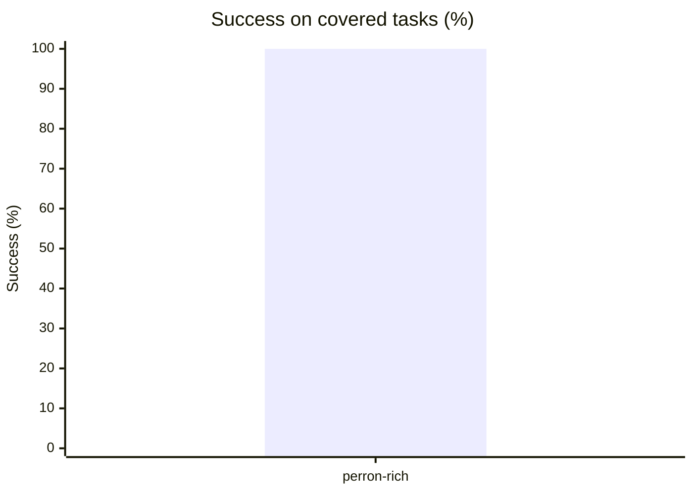
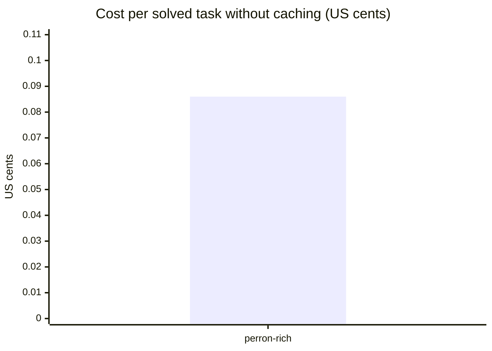

# Perron Bench report

Runs `20261126-094654-smoke`, 2026-11-26. Suite `smoke` (6 tasks), model `claude-haiku-5-5`, effort `medium`, max_tokens 16000, 1 repeat(s) per task and server.

## Success

| Server | Coverage | Success, covered tasks (95 % CI) | Success, all tasks (95 % CI) | pass^1 | Scored runs | Pending | Unscored | Infra errors |
|---|---|---|---|---|---|---|---|---|
| perron-rich | 6/6 | 100 % (100–100) | 100 % (100–100) | 100 % | 6 | 0 | 0 | 0 |

Success is the share of passed scored runs per task, averaged over tasks; the interval is a 95 % percentile bootstrap over tasks (2000 resamples, fixed seed). "All tasks" counts tasks a server does not cover as 0. pass^k: share of covered tasks whose k scored runs all passed. Pending (judge missing) and unscored (no oracle data) runs are not counted.

## Paired comparison with `perron-rich`

`perron-rich` is not part of these runs.

## Cost and efficiency

| Server | Tool definition tokens | Tool calls per run | Failed tool calls | Tokens per run | Cost per task | Cost per solved task | Actual cost per task (cached) | Judge cost (total) | LLM time per run | Tool time per run |
|---|---|---|---|---|---|---|---|---|---|---|
| perron-rich | 2124 | 1.5 | 0 % | 6380 | $0.0009 | $0.0009 | $0.0007 | $0.0004 | 3.1 s | 0.38 s |

Cost per task and per solved task are computed without prompt caching (cache tokens at the input price), because caching favours servers with large tool definitions; the actual cost with caching is shown for reference. Judge cost is not part of the server's cost.

## Errors

| Server | Hallucination rate | infra | tool_limit | gave_up | hallucinated | not_optimal | wrong_time | wrong_stop | tool_error_loop | failed without code |
|---|---|---|---|---|---|---|---|---|---|---|
| perron-rich | 0 % | 0 | 0 | 0 | 0 | 0 | 0 | 0 | 0 | 0 |

Hallucination rate: share of answered runs with a clock time that appears in no tool result of the run; it does not decide whether a task passed, so `hallucinated` is also counted for passed runs. The other codes are counted per run, and a run can have several. "Failed without code": failed runs whose failure the scorer cannot classify, e.g. a judge verdict or a missed regex; such codes are set by hand.

## Methodology

| Run | Started | Commit | Harness | Repeats | Seed |
|---|---|---|---|---|---|
| `20261126-094654-smoke` | 2026-11-26 09:46 UTC | `1e1a58aa1880` | 1.0.0 | 1 | 1545592889 |

- Model `claude-haiku-5-5`, effort `medium`, max_tokens 16000, tool-call limit 8 unless a task sets its own, pause 3 s between runs.
- Task set `tasks/dev.jsonl` (SHA-256 `dd064694d0d2`); system prompt template SHA-256 `026578e015b7`, the same for every server, with the server's instructions in a fixed section.
- Judge for ambiguous and bad input tasks: `claude-haiku-5-5`, effort `medium`, prompt SHA-256 `792656604e81`, blind to the server; its check by review is in `bench/judge-review/agreement.md`.
- Prices (USD per million tokens): input 0.10, output 0.50, cache write 0.125, cache read 0.01.
- Oracle checks verify the named connection or departure against transport.opendata.ch, asked once per task from the reference time; grounding checks every clock time of the answer against the tool results.

| Server | Version | serverInfo | tools/list SHA-256 | Tool definition tokens | Covered | Not covered |
|---|---|---|---|---|---|---|
| perron-rich | repository | perron-rich 1.0.0 | `33ae1692d9fe` | 2124 | stops, trips, departures | – |

Known limitations of the benchmark are listed in the README.

Fahrplandaten: opentransportdata.swiss (via transport.opendata.ch).
