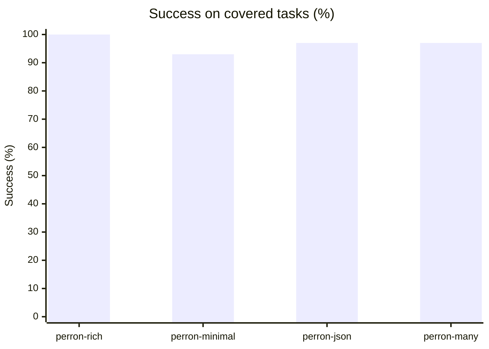
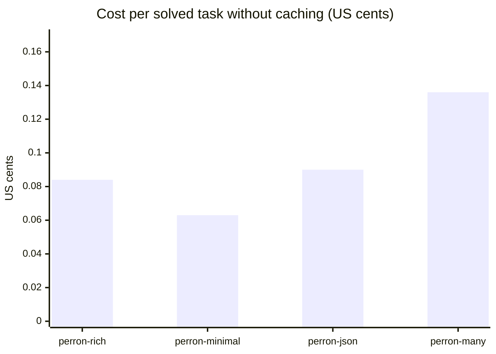

# Perron Bench report

Runs `20261126-175920-full`, 2026-11-26. Suite `full` (25 tasks), model `claude-haiku-5-5`, effort `medium`, max_tokens 16000, 3 repeat(s) per task and server.

## Success

| Server | Coverage | Success, covered tasks (95 % CI) | Success, all tasks (95 % CI) | pass^3 | Scored runs | Pending | Unscored | Infra errors |
|---|---|---|---|---|---|---|---|---|
| perron-rich | 23/25 | 100 % (100–100) | 92 % (80–100) | 100 % | 69 | 0 | 0 | 0 |
| perron-minimal | 23/25 | 93 % (83–100) | 85 % (72–96) | 87 % | 69 | 0 | 0 | 0 |
| perron-json | 23/25 | 97 % (93–100) | 89 % (77–99) | 91 % | 69 | 0 | 0 | 0 |
| perron-many | 23/25 | 97 % (93–100) | 89 % (77–99) | 91 % | 69 | 0 | 0 | 0 |

Success is the share of passed scored runs per task, averaged over tasks; the interval is a 95 % percentile bootstrap over tasks (2000 resamples, fixed seed). "All tasks" counts tasks a server does not cover as 0. pass^k: share of covered tasks whose k scored runs all passed. Pending (judge missing) and unscored (no oracle data) runs are not counted.

## Paired comparison with `perron-rich`

| Server | Tasks compared | Difference in success (95 % CI) | Interval excludes 0 |
|---|---|---|---|
| perron-minimal | 23 | -7 pp (-17 to 0) | no |
| perron-json | 23 | -3 pp (-7 to 0) | no |
| perron-many | 23 | -3 pp (-7 to 0) | no |

Differences in percentage points on the tasks both servers cover and scored, bootstrapped over tasks. Only differences whose interval excludes 0 support a statement in the README.

## Cost and efficiency

| Server | Tool definition tokens | Tool calls per run | Failed tool calls | Tokens per run | Cost per task | Cost per solved task | Actual cost per task (cached) | Judge cost (total) | LLM time per run | Tool time per run |
|---|---|---|---|---|---|---|---|---|---|---|
| perron-rich | 2250 | 1.3 | 6 % | 6433 | $0.0008 | $0.0008 | $0.0004 | $0.0023 | 3.0 s | 0.10 s |
| perron-minimal | 1211 | 1.1 | 8 % | 3995 | $0.0006 | $0.0006 | $0.0004 | $0.0023 | 2.8 s | 0.12 s |
| perron-json | 2250 | 1.2 | 6 % | 6663 | $0.0009 | $0.0009 | $0.0005 | $0.0027 | 3.0 s | 0.12 s |
| perron-many | 4248 | 1.3 | 5 % | 11035 | $0.0013 | $0.0014 | $0.0006 | $0.0034 | 3.0 s | 0.14 s |

Cost per task and per solved task are computed without prompt caching (cache tokens at the input price), because caching favours servers with large tool definitions; the actual cost with caching is shown for reference. Judge cost is not part of the server's cost.

## Errors

| Server | Hallucination rate | infra | tool_limit | gave_up | hallucinated | not_optimal | wrong_time | wrong_stop | tool_error_loop | failed without code |
|---|---|---|---|---|---|---|---|---|---|---|
| perron-rich | 0 % | 0 | 0 | 0 | 0 | 0 | 0 | 0 | 0 | 0 |
| perron-minimal | 0 % | 0 | 0 | 0 | 0 | 2 | 0 | 0 | 0 | 3 |
| perron-json | 1 % | 0 | 0 | 0 | 1 | 0 | 0 | 0 | 0 | 1 |
| perron-many | 1 % | 0 | 0 | 0 | 1 | 0 | 0 | 0 | 0 | 2 |

Hallucination rate: share of answered runs with a clock time that appears in no tool result of the run; it does not decide whether a task passed, so `hallucinated` is also counted for passed runs. The other codes are counted per run, and a run can have several. "Failed without code": failed runs whose failure the scorer cannot classify, e.g. a judge verdict or a missed regex; such codes are set by hand.

## Methodology

| Run | Started | Commit | Harness | Repeats | Seed |
|---|---|---|---|---|---|
| `20261126-175920-full` | 2026-11-26 17:59 UTC | `23b47d9e0176` | 1.0.0 | 3 | 230366860 |

- Model `claude-haiku-5-5`, effort `medium`, max_tokens 16000, tool-call limit 8 unless a task sets its own, pause 3 s between runs.
- Task set `tasks/dev.jsonl` (SHA-256 `dd064694d0d2`); system prompt template SHA-256 `026578e015b7`, the same for every server, with the server's instructions in a fixed section.
- Judge for ambiguous and bad input tasks: `claude-haiku-5-5`, effort `medium`, prompt SHA-256 `792656604e81`, blind to the server; its check by review is in `bench/judge-review/agreement.md`.
- Prices (USD per million tokens): input 0.10, output 0.50, cache write 0.125, cache read 0.01.
- Oracle checks verify the named connection or departure against transport.opendata.ch, asked once per task from the reference time; grounding checks every clock time of the answer against the tool results.

| Server | Version | serverInfo | tools/list SHA-256 | Tool definition tokens | Covered | Not covered |
|---|---|---|---|---|---|---|
| perron-rich | repository | perron-rich 1.0.0 | `c6ac2ff1eb5c` | 2250 | stops, trips, departures | – |
| perron-minimal | repository | perron-minimal 1.0.0 | `efdc70514fe4` | 1211 | stops, trips, departures | – |
| perron-json | repository | perron-json 1.0.0 | `c6ac2ff1eb5c` | 2250 | stops, trips, departures | – |
| perron-many | repository | perron-many 1.0.0 | `6f6230b5ed69` | 4248 | stops, trips, departures | – |

Known limitations of the benchmark are listed in the README.

Fahrplandaten: opentransportdata.swiss (via transport.opendata.ch).
